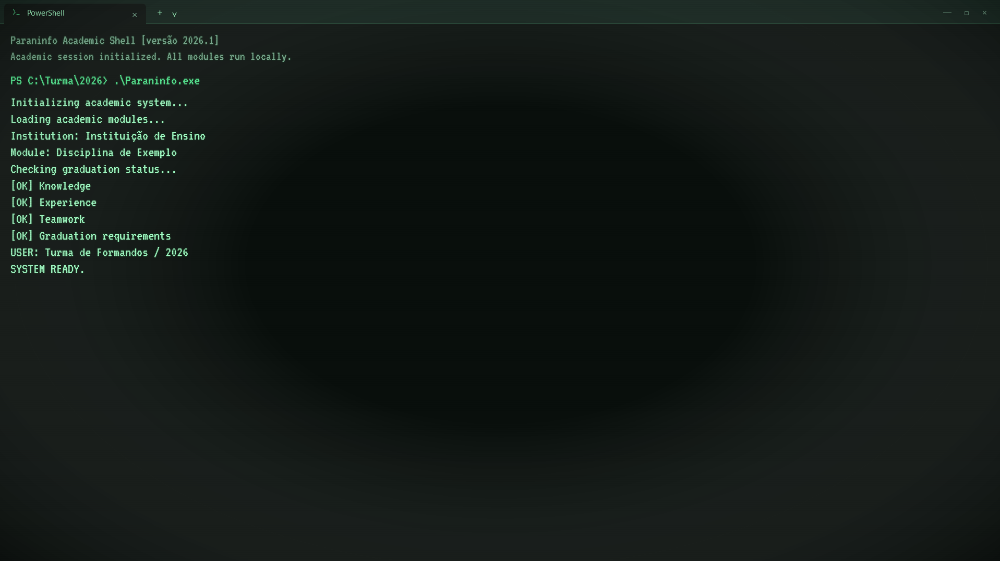
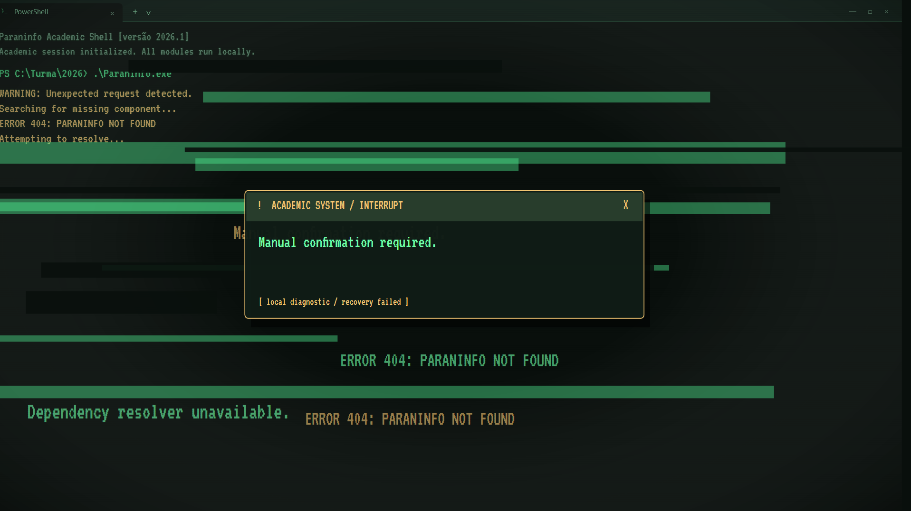
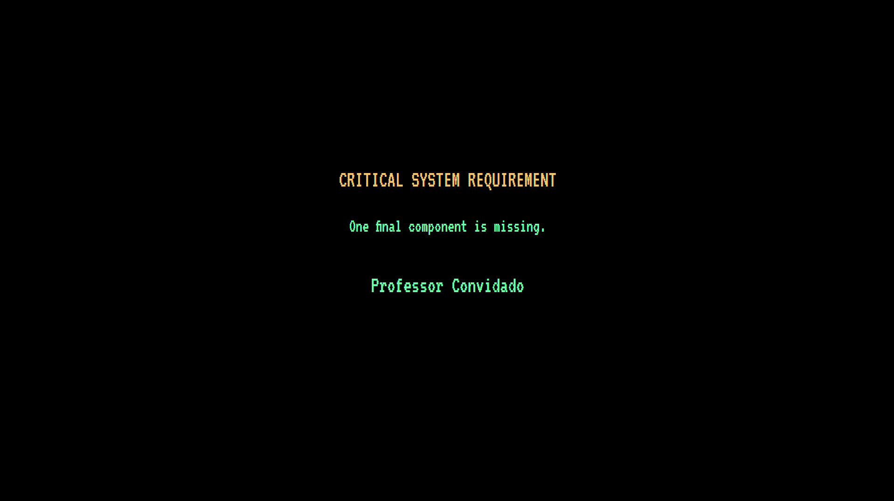
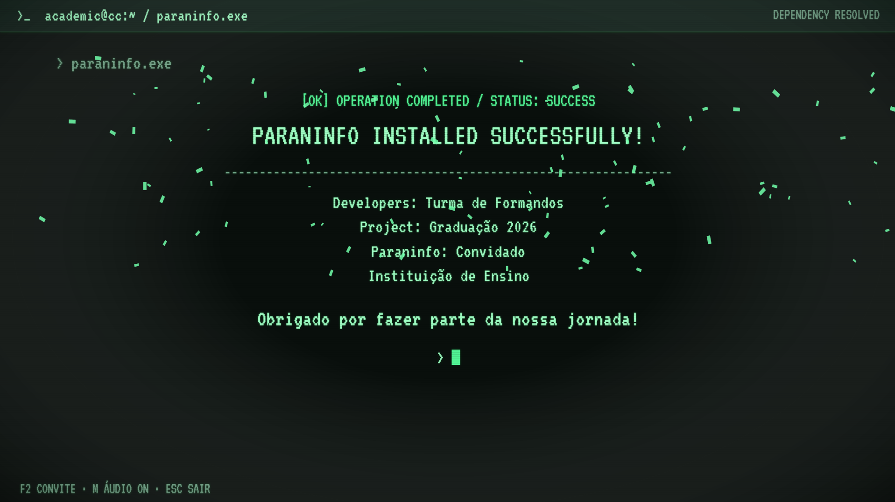
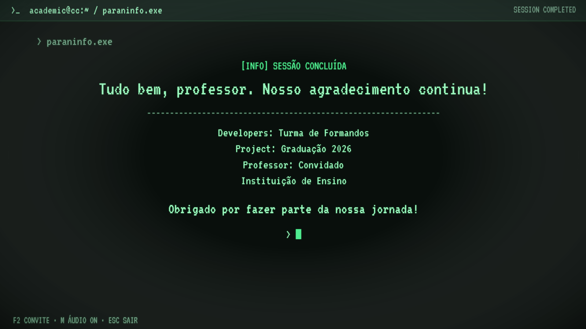

# Pedido_paraninfo — Paraninfo.exe

Aplicativo desktop desenvolvido em **C# com WPF e .NET 8** para transformar um
convite de paraninfo em uma apresentação interativa. A experiência começa como
um terminal clássico, simula uma falha de sistema e revela a pergunta para o
professor, com encerramentos diferentes para aceite e recusa.

O visual combina fonte pixelada, texto verde e acabamento leve de monitor CRT.
Tudo funciona offline e os efeitos ficam restritos à janela do aplicativo.

<div align="center">
<br />
</div>

## Funcionalidades

- Sequência de aproximadamente 35 segundos até o convite, sem prazo para responder.
- Terminal com digitação progressiva, cursor piscante e rolagem automática.
- Glitches, popups de erro e transição abrupta para o alerta de requisito ausente.
- Convite interativo com botões SIM e NÃO; a fuga do NÃO tem um limite configurável.
- Frases da brincadeira exibidas na ordem definida na configuração.
- Comemoração com partículas e som de sucesso após o aceite.
- Encerramento com agradecimento e som de fracasso após a recusa.
- Fonte VT323 incorporada, brilho discreto, scanlines e vinheta configuráveis.
- Tela cheia, navegação por teclado, atalho para pular a introdução e saída a qualquer momento.
- Configuração externa de nomes, mensagens, durações, áudio e efeitos, sem recompilação.
- Publicação portátil para Windows x64, sem instalação prévia do runtime .NET.

## Ferramentas utilizadas

- **[C#](https://learn.microsoft.com/dotnet/csharp/)**
- **[.NET 8](https://dotnet.microsoft.com/)**
- **[WPF](https://learn.microsoft.com/dotnet/desktop/wpf/)**
- **XAML**, para a construção das interfaces.
- **System.Text.Json**, para leitura da configuração externa.
- **Windows Multimedia (WinMM)**, para reprodução dos efeitos sonoros incorporados.
- **[xUnit](https://xunit.net/)**, para os testes automatizados.
- **[VT323](https://github.com/google/fonts/tree/main/ofl/vt323)**, fonte de Peter Hull.

## Estrutura do projeto

- `Paraninfo.App/Views` — terminal, glitches, convite, encerramentos e acabamento CRT.
- `Paraninfo.App/Services` — controle da sequência, configuração, áudio e sincronização da digitação.
- `Paraninfo.App/Models` — estados da apresentação e valores padrão da configuração.
- `Paraninfo.App/Styles` — paleta verde e estilos dos controles.
- `Paraninfo.App/Assets` — fonte e efeitos sonoros incorporados ao executável.
- `Paraninfo.App/config.example.json` — configuração pública genérica.
- `Paraninfo.Tests` — testes da sequência, configuração, digitação e arquivos de áudio.
- `docs` — instruções complementares e roteiro de validação.
- `.github` — capa do portfólio e capturas das etapas da apresentação.

## Configuração

O repositório contém apenas dados genéricos em `Paraninfo.App/config.example.json`.
Por padrão, tanto o build quanto a publicação usam esse modelo e o entregam com
o nome **`config.json`**, ao lado de `Paraninfo.exe`.

Para personalizar uma cópia portátil, feche o programa, edite o `config.json` da
pasta do executável e abra-o novamente. Exemplo dos campos principais:

```json
{
  "professor": "Convidado",
  "disciplina": "Disciplina de Exemplo",
  "turma": "Turma de Formandos",
  "instituicao": "Instituição de Ensino",
  "ano": 2026,
  "tentativasNao": 3,
  "audio": { "enabled": true, "volume": 0.2 },
  "mensagens": {
    "invitation": "Professor, aceita ser nosso paraninfo?",
    "thanks": "Obrigado por fazer parte da nossa jornada!"
  }
}
```

O aplicativo aceita configurações parciais e utiliza os padrões para campos
ausentes. Arquivos ausentes ou inválidos também usam os padrões.
O guia completo de campos, limites e mensagens está em [docs/CONFIGURACAO.md](docs/CONFIGURACAO.md).

Para manter uma personalização local no código-fonte:

```powershell
Copy-Item .\Paraninfo.App\config.example.json .\Paraninfo.App\config.json
```

Edite a cópia `config.json`, que é ignorada pelo Git. Ela só será usada em uma
compilação quando a opção **`-p:UsePrivateConfig=true`** for informada explicitamente.
Não coloque dados pessoais no arquivo público `config.example.json`.

## Pré-requisitos

Para compilar e desenvolver:

- Windows 10 ou Windows 11.
- SDK do .NET 8 ou superior compatível com o projeto.
- Visual Studio com suporte ao desenvolvimento desktop .NET ou outro editor com a CLI do .NET.

Para usar uma publicação portátil, basta Windows x64; não é necessário instalar
.NET, utilizar navegador ou manter conexão com a internet.

## Rodando o projeto

```powershell
# Clone este repositório e acesse a pasta do projeto.
git clone <URL_DO_REPOSITORIO>
cd <PASTA_DO_REPOSITORIO>

# Restaure as dependências e execute com a configuração pública genérica.
dotnet restore .\Paraninfo.sln
dotnet run --project .\Paraninfo.App -- --windowed
```

Para executar com sua configuração local ignorada pelo Git:

```powershell
dotnet run --project .\Paraninfo.App -p:UsePrivateConfig=true -- --windowed
```

Para compilar e publicar a versão portátil **genérica**:

```powershell
dotnet publish .\Paraninfo.App\Paraninfo.App.csproj -p:PublishProfile=Portable
```

A saída fica em `artifacts/Paraninfo-win-x64`. Distribua a pasta inteira, incluindo
`config.json`, `LEIA-ME.txt` e a licença da fonte. Para uma publicação pessoal,
adicione `-p:UsePrivateConfig=true` e mantenha essa saída fora dos arquivos públicos.

Os arquivos pessoais, pastas `bin`, `obj` e `artifacts`, executáveis e ZIPs estão
no `.gitignore`. Pacotes de release são distribuídos separadamente do código-fonte.

Para executar os testes, sem abrir a janela do aplicativo:

```powershell
dotnet test .\Paraninfo.Tests\Paraninfo.Tests.csproj --verbosity quiet
```

## Fluxo de utilização

1. Abra o aplicativo e acompanhe a inicialização do terminal.
2. A sequência apresenta glitches, erros e um alerta sobre a dependência ausente.
3. O professor recebe o convite e escolhe entre aceitar e recusar.
4. Após a resposta, o programa exibe o encerramento correspondente e permanece aberto até sair.

| Controle | Ação |
| --- | --- |
| `ESC` ou `Alt + F4` | Encerra em qualquer etapa |
| `F2` | Pula a introdução e abre o convite |
| `M` | Liga ou desliga o áudio |
| `Tab` / `Shift + Tab` | Navega entre os botões |
| `Enter` / `Espaço` | Aciona o botão selecionado |
| `--windowed` | Abre em janela |
| `--presentation` | Força a apresentação em tela cheia |
| `--skip` | Inicia diretamente no convite |

O NÃO pode ser acionado pelo teclado desde o início. A aplicação não bloqueia
atalhos do Windows, não manipula outros programas e não realiza ações de malware.
Antes de uma apresentação, siga o [roteiro de validação](docs/VALIDACAO.md).

## Etapas da apresentação

As capturas abaixo usam a configuração genérica. Os nomes e a ordem dos arquivos
estão documentados em [.github/README.md](.github/README.md).

### Início

<div align="center">

</div>

### Glitch

<div align="center">

</div>

### Alerta

<div align="center">

</div>

### Pergunta

<div align="center">

</div>

### Confirmação positiva

<div align="center">

</div>

### Confirmação negativa

<div align="center">

</div>

## Desenvolvedores

<table align="center">
<tr>
<td>
<div align="center">
<br />
<a href="https://github.com/CaduZulian">Carlos Eduardo Zulian</a>
</div>
</td>
</tr>
</table>

## Créditos

O acabamento de monitor antigo tem como referência o
[cool-retro-term](https://github.com/Swordfish90/cool-retro-term).
A fonte VT323 foi incorporada sem modificações, sob SIL Open Font License 1.1;
a licença está em [OFL-VT323.txt](Paraninfo.App/Assets/Fonts/OFL-VT323.txt) e acompanha a publicação.
